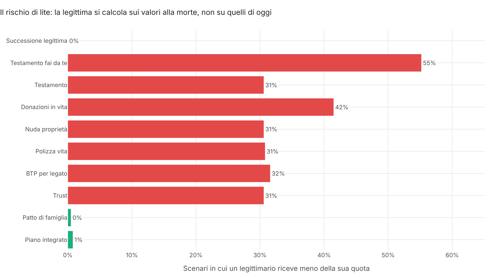
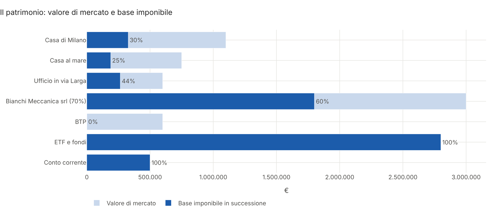
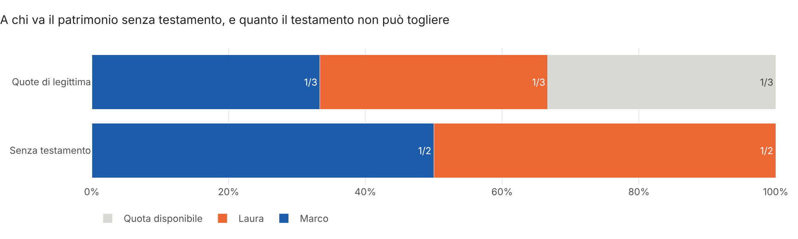
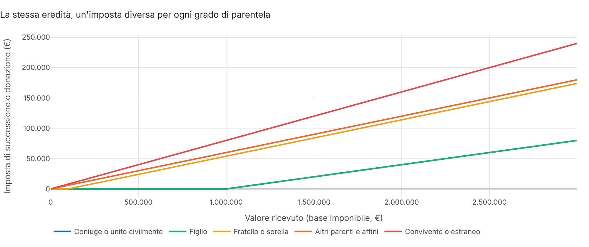
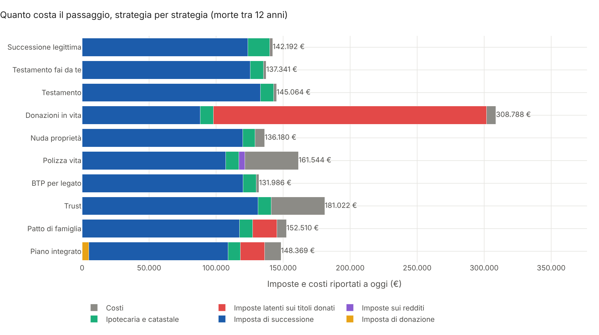
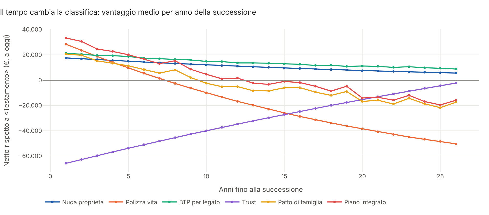
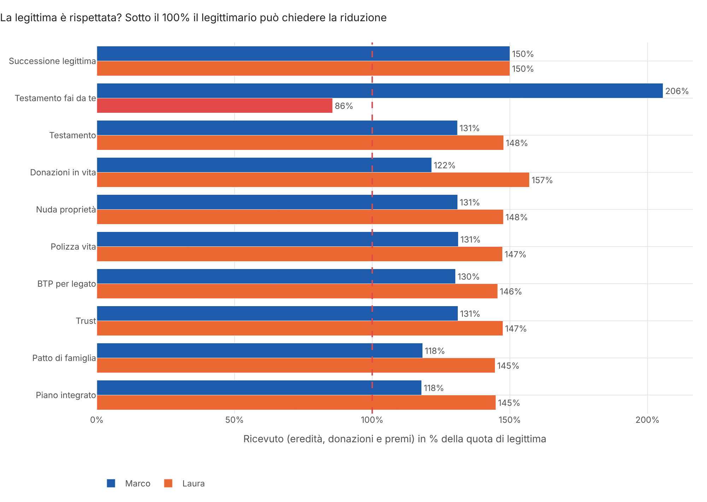
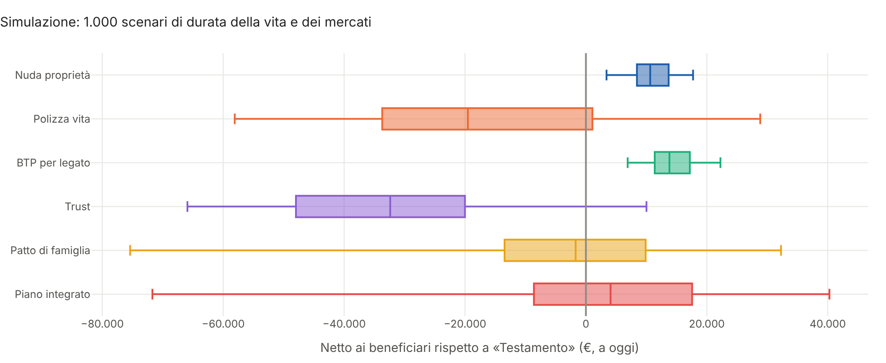

# Passaggio generazionale

**Successioni e donazioni in Italia, in Python: quote di legittima, imposte con le franchigie per grado di parentela,
valori catastali e nuda proprietà, e un confronto quantitativo tra testamento, donazioni, nuda proprietà, polizze vita,
titoli di Stato, trust e patto di famiglia su un caso completo, con una simulazione Monte Carlo della durata della vita
e dei mercati.**

In Italia l'imposta di successione in famiglia costa poco: 4% oltre un milione per figlio, sul valore catastale degli
immobili, con aziende e titoli di Stato esenti. I costi veri del passaggio generazionale sono altrove. La compagna
convivente paga l'8% senza franchigia e, senza testamento, non riceve nulla. I titoli donati in vita perdono
l'aggiornamento del costo fiscale che avrebbero in eredità. E soprattutto la **legittima si calcola alla morte, sui
valori di allora**: un testamento equilibrato oggi può diventare lesivo se l'azienda lasciata a un figlio e gli
immobili lasciati all'altro crescono in modo diverso. Il progetto risponde alle domande che un consulente patrimoniale
si pone con una famiglia: **chi eredita senza testamento e quanto il testamento non può togliere? Quanto costa il
passaggio, strumento per strumento? Chi riceve cosa, al netto? E quanto è probabile che finisca in una lite?** Il
risultato è un **report HTML interattivo** per la famiglia.



## Cosa fa

| Area | Contenuto |
|---|---|
| **Quote** | Successione legittima (coniuge, figli, genitori e fratelli, artt. 565-586 c.c.) e quote di riserva dei legittimari (artt. 536-552 c.c.) come frazioni esatte; quota disponibile |
| **Imposte** | Aliquote e franchigie per grado di parentela (4% oltre 1 milione, 6% oltre 100.000 per i fratelli, 6% e 8% senza franchigia), franchigia di 1,5 milioni per le persone con disabilità grave; **franchigie separate** per donazioni e successione (D.Lgs. 139/2024) e cumulo tra donazioni successive (art. 57 TUS); imposte ipotecaria e catastale con i minimi e l'agevolazione prima casa |
| **Basi imponibili** | Valore catastale degli immobili (rendita × 1,05 × moltiplicatore per categoria, 110 per la prima casa), patrimonio netto per le società non quotate, **esenzione** dei titoli di Stato e delle partecipazioni di controllo a coniuge e discendenti; usufrutto e nuda proprietà per età con il prospetto del D.P.R. 131/1986 |
| **Strumenti** | Testamento con assegnazioni, legati in denaro e legati di usufrutto; donazioni anche di nuda proprietà; polizze vita (capitale esente, rendimento tassato, costi, premi nella legittima); trust con tassazione in entrata o in uscita e costi del trustee; **patto di famiglia** con liquidazione dei legittimari (fuori da collazione e riduzione) |
| **Imposte sui redditi** | Plusvalenze realizzate per pagare un premio, rendimento della polizza alla morte, e **imposte latenti** sui titoli donati, che conservano il costo del donante mentre quelli ereditati lo aggiornano al valore di successione (art. 68 TUIR) |
| **Legittima** | Riunione fittizia (relictum + donatum, denaro al nominale, nuda proprietà al valore pieno, premi delle polizze), imputazione delle liberalità ricevute, lesione per ogni legittimario |
| **Confronto** | Ogni strategia portata all'anno della successione: valore ricevuto, imposte, costi e netto per beneficiario, tutto riportato a oggi |
| **Simulazione** | Monte Carlo con l'anno della morte da una legge di Gompertz calibrata sulla speranza di vita italiana e rendimenti correlati di immobili, azioni, obbligazioni, azienda e liquidità: netto atteso, distribuzione e **probabilità di lesione della legittima** per strategia |
| **Report** | HTML in italiano con 10 grafici interattivi Plotly e le tabelle di quote, patrimonio, confronto, legittima, simulazione e registro delle imposte |

Tutto è scritto da zero su `numpy` e `pandas`, così ogni regola è leggibile e verificabile. Grafici `plotly`, report
`jinja2`.

## Avvio rapido

```bash
git clone https://github.com/Torraf-MI/passaggio-generazionale.git
cd passaggio-generazionale
pip install -e ".[png]"

# Report del caso dimostrativo (circa 20 secondi con 1.000 scenari)
passaggio-generazionale --demo

# Senza la simulazione Monte Carlo (un secondo)
passaggio-generazionale --demo --veloce

# Una famiglia descritta in un file JSON, con i grafici anche in PNG
passaggio-generazionale --config esempi/famiglia_bianchi.json --grafici output/img

# Successione tra 5 anni invece che alla speranza di vita; report utilizzabile senza rete
passaggio-generazionale --demo --anni 5 --offline
```

Il report viene salvato in `output/report.html`. Un esempio già generato:
[`docs/report_esempio.html`](docs/report_esempio.html).

Il file JSON ([`esempi/famiglia_bianchi.json`](esempi/famiglia_bianchi.json)) descrive la famiglia, i beni e le
strategie da confrontare:

```json
"persone": [{"nome": "Elena", "parentela": "estraneo", "eta": 66, "prima_casa": true}],
"beni": [
  {"nome": "Casa di Milano", "tipo": "immobile", "valore": 1100000, "rendita": 2600, "categoria": "A/2"},
  {"nome": "Bianchi Meccanica srl (70%)", "tipo": "partecipazione", "valore": 3000000,
   "valore_fiscale": 1800000, "quota_societaria": 0.7},
  {"nome": "ETF e fondi", "tipo": "fondi", "valore": 2800000, "costo_fiscale": 1900000}
],
"strategie": [{
  "nome": "Piano integrato",
  "atti": [{"tipo": "patto_di_famiglia", "assegnatario": "Marco", "bene": "Bianchi Meccanica srl (70%)",
            "liquidazioni": {"Laura": 1000000}, "da_beni": ["BTP", "Conto corrente"]},
           {"tipo": "donazione", "beneficiario": "Laura", "bene": "Casa al mare", "nuda_proprieta": true}],
  "testamento": {"usufrutti": {"Casa di Milano": "Elena"}, "legati": {"Elena": 400000, "Sofia": 200000},
                 "residuo": {"Marco": 0.45, "Laura": 0.55}}
}]
```

Le parentele sono `coniuge`, `figlio`, `discendente`, `ascendente`, `fratello`, `parente` ed `estraneo`; i beni
`immobile`, `partecipazione`, `titoli_stato`, `fondi` e `liquidita`; gli atti `donazione`, `polizza`, `trust` e
`patto_di_famiglia`.

## Uso come libreria

```python
from passaggio_generazionale import (Bene, Donazione, Famiglia, Parentela, Persona, Strategia, Testamento,
                                     TipoBene, esegui, imposta, quote_riserva)

quote_riserva("Anna", ["Marco", "Laura"])            # {'Anna': 1/4, 'Marco': 1/4, 'Laura': 1/4}
imposta(1_500_000, Parentela.FIGLIO)                 # 20.000 €
imposta(400_000, Parentela.ESTRANEO)                 # 32.000 €

famiglia = Famiglia("Giorgio", 74, persone=[Persona("Marco", Parentela.FIGLIO, 46),
                                            Persona("Elena", Parentela.ESTRANEO, 66)])
beni = [Bene("BTP", TipoBene.TITOLI_STATO, 400_000), Bene("Conto", TipoBene.LIQUIDITA, 2_000_000)]
lascito = Strategia("BTP a Elena", testamento=Testamento(assegnazioni={"BTP": {"Elena": 1.0}},
                                                         residuo={"Marco": 1.0}))
dono = Strategia("Donazione", atti=[Donazione("Marco", "Conto", importo=1_000_000)],
                 testamento=Testamento(assegnazioni={"BTP": {"Elena": 1.0}}, residuo={"Marco": 1.0}))
for s in (lascito, dono):
    e = esegui(s, famiglia, beni, anno_morte=12)
    print(s.nome, e.costi().round(), e.legittima.lesioni)
```

Esempio completo in [`examples/esempio.py`](examples/esempio.py). L'analisi completa è `analizza(configurazione)`, la
simulazione `simula(strategie, famiglia, beni)`.

## Risultati sull'esempio dimostrativo

Il caso è di fantasia ma costruito sulle situazioni tipiche. Giorgio Bianchi, 74 anni, è vedovo e convive da quindici
anni con Elena (66). Ha due figli: Marco (46) lavora nell'azienda di famiglia, Laura (42) fa il medico; Sofia (12) è la
figlia di Laura. Il patrimonio vale 9,35 milioni: la casa di Milano, una casa al mare, un ufficio, il 70% della Bianchi
Meccanica srl, BTP, ETF con 900.000 € di plusvalenze latenti e liquidità. Giorgio vuole l'azienda a Marco, gli
immobili a Laura, la casa di Milano a vita per Elena con 400.000 € e 200.000 € per Sofia. La speranza di vita è di
12,5 anni: il confronto è fatto con la successione tra 12 anni e i rendimenti attesi, e gli importi sono riportati a
oggi al 3%.

**La base imponibile è il 63% del patrimonio.** Gli immobili, che valgono 2,45 milioni, pagano su 781.000 € di valore
catastale; l'azienda paga sul patrimonio netto ed è comunque esente se va a un figlio con il controllo; i BTP sono
esenti.



**Senza testamento Elena e Sofia non ricevono nulla.** I figli ereditano metà ciascuno; il testamento può disporre
liberamente solo di un terzo. Il passaggio con il testamento costa 145.064 € tra imposte e spese, l'1,6% del
patrimonio: in famiglia l'imposta pesa poco.



**Il grado di parentela conta più del patrimonio.** Gli stessi 400.000 € costano 0 € a un figlio e 32.000 € a Elena,
che per il fisco è un'estranea. Lasciati in BTP invece che in denaro non pagano nulla, perché i titoli di Stato non
entrano nell'attivo ereditario chiunque li riceva: è la mossa più efficiente del confronto (+13.078 € di netto).



| Strategia (morte tra 12 anni, valori a oggi) | Imposte e costi | di cui latenti | Netto ai beneficiari | Rispetto al testamento |
|---|---|---|---|---|
| Successione legittima | 142.192 € | – | 9.918.000 € | +2.871 € (ma nulla a Elena e Sofia) |
| Testamento fai da te | 137.341 € | – | 9.922.851 € | lesione di 687.728 € a Laura |
| **Testamento** | **145.064 €** | – | **9.915.129 €** | – |
| Donazioni in vita (azienda e 1 milione di ETF) | 308.788 € | 203.747 € | 9.752.212 € | −162.917 € |
| Nuda proprietà di casa al mare e ufficio | 136.180 € | – | 9.926.248 € | +11.119 € |
| Polizza vita per Elena | 161.544 € | – | 9.898.649 € | −16.480 € |
| BTP per legato a Elena | 131.986 € | – | 9.928.206 € | +13.078 € |
| Trust per Sofia | 181.022 € | – | 9.880.518 € | −34.611 € |
| Patto di famiglia | 152.510 € | 18.142 € | 9.908.490 € | −6.639 € |
| **Piano integrato** | **148.369 €** | 18.142 € | **9.915.658 €** | **+530 €** |



**Donare i titoli sbagliati costa più di quanto si risparmia.** Donare oggi un milione di ETF a Laura usa una
seconda franchigia e fa risparmiare 45.000 € di imposta di successione. Ma gli ETF donati conservano il costo fiscale
di Giorgio: alla vendita Laura pagherà il 26% su plusvalenze che, ereditate, sarebbero state azzerate. L'imposta
latente vale 203.747 €. La seconda franchigia va usata con liquidità, immobili o titoli senza plusvalenze.

**Nuda proprietà, polizza e trust: utili, ma non per risparmiare.** La nuda proprietà della casa al mare e
dell'ufficio a 74 anni vale il 65% e alla morte l'usufrutto si riunisce senza imposte: +11.119 €, perché la base è già
catastale. La polizza vita rende esenti i 400.000 € di Elena, ma l'1% di costi annui in più si mangia il risparmio
dopo circa sette anni: conviene se la successione è vicina, e dà a Elena liquidità subito e fuori dall'eredità. Il
trust costa 40.000 € in tredici anni su 200.000 €: serve a proteggere e governare il patrimonio di una minorenne, non a
pagare meno.



**Il rischio vero è la lite.** La legittima si verifica alla morte, con i valori di allora. Il «testamento fai da te»
(azienda ed ETF a Marco, immobili a Laura) lede già Laura per 687.728 € nello scenario atteso. Ma anche il testamento
equilibrato, che oggi lascia a ciascun figlio più della sua quota, diventa lesivo nel **31% dei 1.000 scenari
simulati**, con una lesione media di 800.051 €: basta che l'azienda di Marco perda valore rispetto al resto. Donazioni,
nuda proprietà, polizza e trust non cambiano questo rischio.



**Il piano integrato.** Con un **patto di famiglia** l'azienda passa oggi a Marco, esente da imposta, e Laura riceve
subito 1 milione in BTP e liquidità come liquidazione della sua quota, nella sua franchigia. Quanto attribuito con il
patto esce dal calcolo della legittima e non può più essere ridotto. Il resto va per testamento in quote dello stesso
patrimonio (55% a Laura, 45% a Marco), che si muovono insieme; Elena ha l'usufrutto della casa e 400.000 €, Sofia
200.000 €; Laura e Marco ricevono oggi la nuda proprietà della casa al mare e dell'ufficio. Costa quanto il
testamento, ma la probabilità di lesione scende dal 31% all'1%.

| Strategia (1.000 scenari) | Netto medio | Differenza media | 5° percentile | Scenari migliori | Scenari con lesione |
|---|---|---|---|---|---|
| Testamento | 10.089.432 € | – | – | – | 31% |
| Nuda proprietà | 10.100.475 € | +11.043 € | +6.163 € | 100% | 31% |
| Polizza vita | 10.073.263 € | −16.169 € | −47.148 € | 26% | 31% |
| BTP per legato | 10.103.772 € | +14.340 € | +8.996 € | 100% | 32% |
| Trust | 10.055.831 € | −33.602 € | −62.663 € | 1% | 31% |
| Patto di famiglia | 10.086.591 € | −2.841 € | −35.202 € | 46% | 0% |
| **Piano integrato** | **10.092.504 €** | **+3.071 €** | −30.224 € | 57% | **1%** |



La pianificazione, qui, non serve tanto a pagare meno imposte: con un patrimonio di 9 milioni le strategie efficienti
spostano poche decine di migliaia di euro. Serve a fare arrivare il patrimonio a chi si vuole, a partire da chi la
legge non tutela, e a evitare che una differenza di rendimento tra un'azienda e una casa si trasformi in una causa tra
fratelli.

## Metodologia in breve

- **Quote**: senza testamento coniuge e figli (1/2 e 1/2 con un figlio; 1/3 e 2/3 con più figli), coniuge con
  genitori e fratelli (2/3; agli ascendenti almeno 1/4), genitori e fratelli per capi (ai genitori almeno 1/2). Riserve:
  figli 1/2 o 2/3, coniuge 1/2, coniuge e un figlio 1/3 ciascuno, coniuge e più figli 1/4 e 1/2, genitori 1/3, coniuge
  e genitori 1/2 e 1/4.
- **Imposta**: aliquota per parentela sulla base imponibile di ciascun beneficiario oltre la franchigia. Le donazioni
  successive allo stesso beneficiario consumano la franchigia; dal 2025 le donazioni non si cumulano con la successione.
  Ipotecaria 2% e catastale 1% (minimo 200 € ciascuna), 200 € fisse con i requisiti prima casa.
- **Basi imponibili**: immobili al valore catastale; partecipazioni non quotate al patrimonio netto, esenti se a coniuge
  o discendenti con il controllo (anche indivise, con un rappresentante comune); titoli di Stato esenti in successione
  (per prudenza tassati nelle donazioni); polizze vita esenti. Usufrutto vitalizio dal 95% al 10% del valore secondo
  l'età; legato di usufrutto valutato con l'età dell'usufruttuario alla morte.
- **Patto di famiglia**: trasferimento esente dell'azienda; liquidazioni tassate come donazioni del disponente
  (art. 58 TUS, ris. 12/E/2025); attribuzioni escluse dalla riunione fittizia.
- **Imposte sui redditi**: 26% (12,5% sui titoli di Stato) sulle plusvalenze realizzate per pagare un premio, sul
  rendimento della polizza alla morte e, come imposta latente, sulle plusvalenze dei titoli donati alla data della
  successione.
- **Legittima**: massa = beni alla morte + donazioni (denaro al nominale, altri beni al valore all'apertura e in piena
  proprietà) + premi delle polizze + conferimenti in trust; ricevuto = eredità + liberalità imputate; lesione = quota ×
  massa − ricevuto.
- **Simulazione**: anno della morte da una legge di Gompertz (età modale 86,7 anni per gli uomini e 90,7 per le donne,
  calibrate su una speranza di vita a 74 anni di 12,5 e 14,9 anni); rendimenti lognormali correlati (immobili 2%,
  azioni 5%, obbligazioni 2,5%, azienda 4%, liquidità 1,5%); redditi dei beni consumati dal disponente allo stesso modo
  in ogni strategia; stessi scenari per tutte le strategie; importi scontati al 3%.

## Struttura

```
src/passaggio_generazionale/
├── normativa.py       # aliquote, franchigie, valori catastali, usufrutto, ipotecaria e catastale
├── famiglia.py        # persone, parentele, legittimari
├── patrimonio.py      # beni con valore di mercato, base imponibile e costo fiscale
├── legittima.py       # successione legittima, quote di riserva, riunione fittizia e lesione
├── strategie.py       # donazioni, polizze, trust, patto di famiglia, testamento e motore di calcolo
├── mercato.py         # crescita attesa e scenari correlati dei beni
├── simulazione.py     # durata della vita (Gompertz) e Monte Carlo delle strategie
├── dati.py            # caso dimostrativo
├── configurazione.py  # caso dimostrativo e lettura/scrittura JSON
├── analisi.py         # analisi completa
├── report.py          # grafici Plotly e report HTML
├── cli.py             # riga di comando
└── templates/         # modello del report
esempi/                # la famiglia dimostrativa in JSON
examples/              # uso come libreria
tests/                 # 52 test (pytest), eseguiti a ogni push con GitHub Actions
```

## Test

```bash
pip install -e ".[dev]"
pytest
```

I test verificano le regole su casi calcolati a mano. Quote ab intestato e di riserva per tutte le combinazioni di
coniuge, figli, genitori e fratelli. Usufrutto per fascia d'età, valori catastali per categoria, imposte con e senza
franchigia e con la franchigia per disabilità, minimi di ipotecaria e catastale. Nel motore: 4% oltre il milione,
doppia franchigia tra donazione e successione e cumulo tra due donazioni, titoli di Stato esenti anche per
un'estranea, polizza esente con il solo rendimento tassato e i premi nella legittima, plusvalenza tassata se il premio
si paga vendendo titoli, nuda proprietà al 65% a 74 anni con la piena proprietà alla morte, partecipazione esente in
famiglia e tassata all'8% per un'estranea, titoli donati con l'imposta latente, legato di usufrutto, legati in denaro,
trust tassato in entrata e in uscita, patto di famiglia fuori dalla massa. Sul caso dimostrativo: lesione del testamento
fai da te, nulla a Elena senza testamento, rischio di lesione del piano integrato sotto il 5%. La speranza di vita è
calibrata, gli scenari rispettano la media; JSON, report e riga di comando funzionano dall'inizio alla fine.

## Avvertenze

Le regole sono quelle in vigore nel 2026 per un disponente residente in Italia con beni in Italia: D.Lgs. 346/1990
come modificato dal D.Lgs. 139/2024, codice civile, TUIR. Non sono considerati debiti e spese deducibili, beni
all'estero, rappresentazione e fratelli unilaterali, collazione tra coeredi, cautela sociniana, diritto di
abitazione del coniuge, tassazione dei redditi del trust, imposta di bollo, plusvalenze latenti sulle partecipazioni,
agevolazioni prima casa per l'imposta (solo per ipotecaria e catastale), patrimoni con disabili («Dopo di noi»). Le
regole sulla circolazione degli immobili donati (artt. 561 e 563 c.c.) sono state riformate a fine 2025 e non cambiano
il calcolo della legittima. Il valore dell'azienda, i rendimenti e i costi di polizze, trust e notai sono stime.
Persone, beni e valori dell'esempio sono di fantasia. Il progetto ha scopo dimostrativo e non costituisce consulenza
legale, fiscale né finanziaria: ogni scelta va verificata con un notaio e un consulente.

## Licenza

MIT. Autore: Francesco Torraco.
